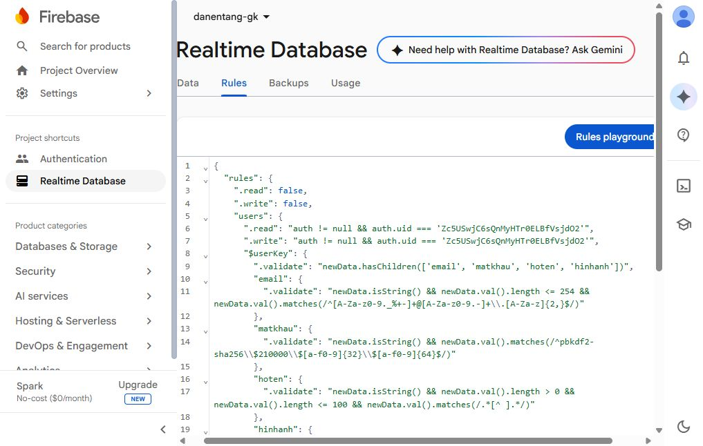
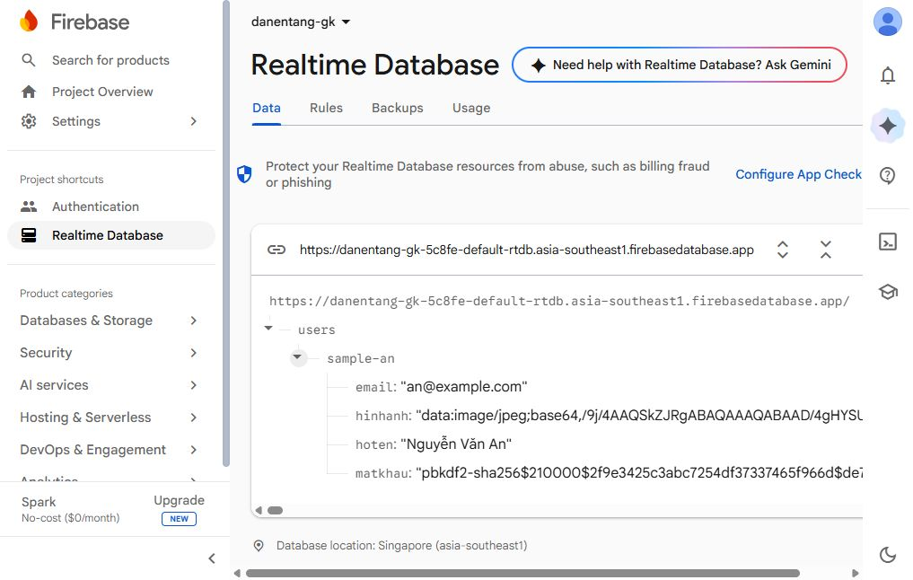
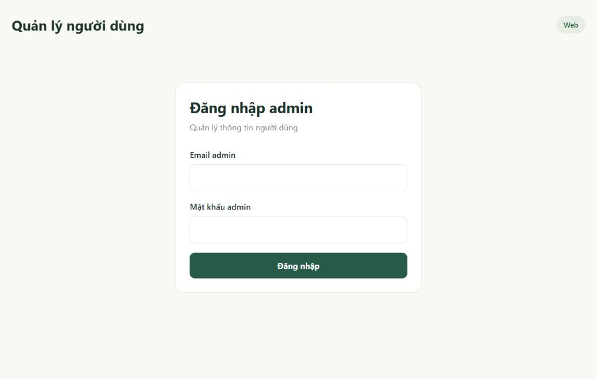
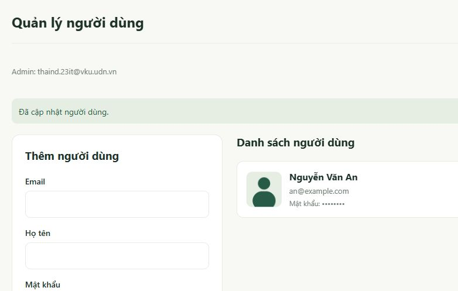
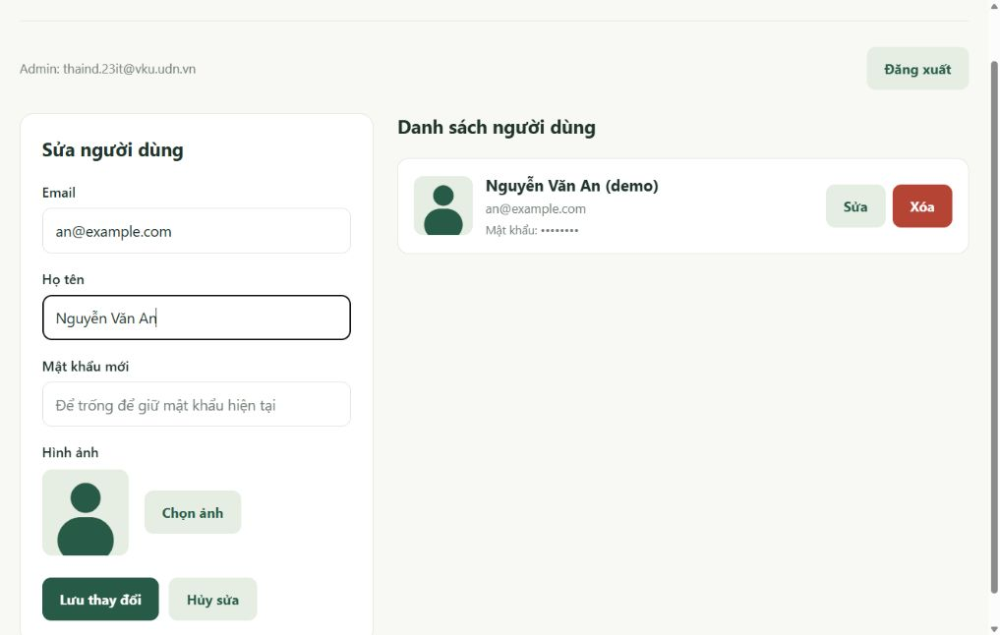
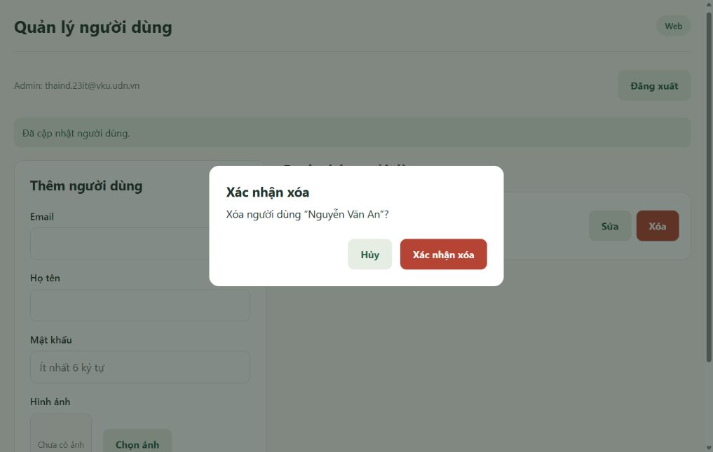

# Báo cáo giữa kỳ Lập trình đa nền tảng

## 1 Mục tiêu và phạm vi

Xây dựng ứng dụng quản lý người dùng ở phân hệ admin bằng React Native, Expo và Firebase. Các chức năng gồm đăng nhập, thêm, hiển thị, sửa, xóa người dùng; chọn và hiển thị ảnh trên web và điện thoại. Không bổ sung trường dữ liệu ngoài đề.

Project Firebase: `danentang-gk-5c8fe`. Web App: `danentang-gk-expo`. Realtime Database đặt tại Singapore. Gói Spark miễn phí được giữ nguyên; không dùng Storage, SMS, Functions hay nâng cấp Blaze.

## 2 Cơ sở dữ liệu

Dữ liệu nằm ở `users/{userKey}`. Mỗi bản ghi chỉ có các trường sau:

| Trường | Kiểu | Ý nghĩa |
|---|---|---|
| email | string | Địa chỉ email |
| matkhau | string | Mật khẩu được băm PBKDF2 SHA256, có salt |
| hoten | string | Họ tên người dùng |
| hinhanh | string | Ảnh JPEG được thu nhỏ và mã hóa Base64 |

Khóa userKey là khóa của node Firebase, không lưu thêm thành trường id. Không có role, createdAt, updatedAt hoặc trường khác. Dữ liệu mẫu để nộp nằm ở `database.json`; ảnh được lưu bên trong file, không phụ thuộc đường dẫn ảnh ngoài.

Tài khoản admin thuộc Firebase Authentication, tách khỏi các bản ghi người dùng mà admin quản lý. Chỉ UID của admin được đọc/ghi users theo Database Rules. Mật khẩu admin do người dùng tự đặt và không được ghi vào mã nguồn.

## 3 Cài đặt thư viện

Dự án sử dụng base Expo TypeScript SDK 57. Các lệnh liên quan:

```powershell
npx create-expo-app@latest . --template blank-typescript@sdk-57
npx expo install react-dom react-native-web react-native-safe-area-context
npx expo install expo-image-picker expo-image-manipulator expo-crypto
npm install firebase@12 @noble/hashes
npm install --save-dev firebase-tools@15.35.0 @firebase/rules-unit-testing@5
npm install
```

Giữ package-lock.json để tái lập phiên bản. package.json thống nhất phiên bản Firebase App và App Compat để tránh hai bản registry khiến Authentication không được đăng ký. Khuyến nghị Node.js 24 LTS từ 24.12 trở lên.

## 4 Các bước cấu hình Firebase

1. Mở project danentang-gk trong Firebase Console.
2. Đăng ký Web App danentang-gk-expo. Chỉ dùng Firebase JS SDK cho Auth và Realtime Database; không đưa Analytics vào app.
3. Tạo Realtime Database tại Singapore, khởi tạo ở locked mode.
4. Mở Authentication, bật Email/Password. Tài khoản admin được tự tạo trong Users.
5. Lấy UID admin và cấu hình cùng UID trong `src/config/firebaseConfig.ts` và `database.rules.json`.
6. Rules chỉ cho UID này đọc/ghi users, bắt buộc bốn trường và từ chối trường khác. Mật khẩu phải ở dạng băm, ảnh phải là data URL JPEG với giới hạn kích thước.
7. Xuất bản rules. Nhập file database.json vào database đang trống để tạo bản ghi mẫu Nguyễn Văn An.





## 5 Cách chương trình hoạt động

`App.tsx` theo dõi trạng thái Firebase Auth, chỉ mở màn hình quản lý khi UID trùng admin đã cấu hình. Màn hình đăng nhập gọi signInWithEmailAndPassword; đăng xuất gọi signOut. Phiên đăng nhập giữ trong bộ nhớ, không thêm chức năng ghi nhớ tài khoản.

`UserForm.tsx` nhận email, họ tên, mật khẩu và ảnh. expo-image-picker mở bộ chọn ảnh; expo-image-manipulator thu nhỏ cạnh dài tối đa 512px, chuyển JPEG và xuất Base64. Ảnh xem trước bằng React Native Image. Khi lưu, dịch vụ tự tạo object chỉ gồm bốn trường. Không ghi trạng thái giao diện hoặc userKey vào dữ liệu.

Mật khẩu được băm PBKDF2 SHA256 với 210000 vòng và salt ngẫu nhiên 16 byte. Mọi thông tin thuật toán nằm trong chuỗi matkhau. Danh sách hiển thị dấu che thay vì mật khẩu nguyên văn. Khi sửa và để trống mật khẩu mới, giá trị matkhau cũ được giữ lại; ảnh cũ cũng được giữ nếu không chọn ảnh mới.

Danh sách dùng onValue để cập nhật từ Firebase. Thêm dùng push và set; sửa dùng set vào khóa hiện tại; xóa dùng remove sau hộp xác nhận. Giao diện thông báo kết quả thành công hoặc thất bại.









## 6 Chạy và kiểm tra

```powershell
npm start
npm run web
npm run typecheck
npm test
npm run test:rules
npm run build:web
npx expo export --platform android --platform ios --output-dir .expo/native-check
```

Mỗi lệnh chạy riêng theo mục đích. Với điện thoại, giữ Metro chạy, dùng cùng Wi-Fi và quét mã QR bằng Expo Go. iOS Simulator cần macOS; có thể thử iPhone thật từ máy Windows bằng Expo Go.

Kiểm thử rules chạy trên Firebase Emulator với project demo-danentang-gk, hoàn toàn tách khỏi database thật. Cần Java 21 trở lên; README ghi cách dùng Java đi kèm Android Studio.

Kết quả đã xác minh: TypeScript đạt; bốn kiểm tra cấu trúc/đầu vào/mật khẩu đạt; ba kiểm tra rules đạt, gồm CRUD admin, chặn tài khoản khác và từ chối dữ liệu sai. Mã nguồn đã xuất bundle web, Android và iOS. Trên web dùng Firebase thật đã kiểm tra đăng nhập, đăng xuất, hiển thị danh sách, chọn/chuyển ảnh JPEG, sửa họ tên, giữ mật khẩu cũ và Hủy trong hộp xác nhận xóa. Chưa chạy thao tác Thêm và xác nhận xóa qua giao diện trên database thật; quyền tạo/xóa đã được kiểm thử trong Emulator. Chưa chạy trên điện thoại thật.

## 7 Trình tự video demo và nộp bài

1. Giới thiệu project và bốn trường trong database.
2. Chạy web, đăng nhập admin.
3. Thêm người dùng kèm ảnh và kiểm tra database cập nhật.
4. Sửa họ tên/ảnh, thử giữ mật khẩu cũ.
5. Bấm Xóa, thử Hủy, rồi xác nhận xóa bản ghi thử.
6. Đăng xuất.
7. Mở bằng Expo Go trên điện thoại để chọn và hiển thị ảnh cùng thông tin.

Nộp mã nguồn, báo cáo, database.json, link GitHub source code và link video demo theo yêu cầu đề. Khi xuất dữ liệu mới nhất, dùng Export JSON ở gốc Realtime Database. Không import đè dữ liệu đang dùng nếu cần giữ lại.

## 8 Tài liệu tham khảo

- https://docs.expo.dev/guides/using-firebase/
- https://firebase.google.com/docs/database/security
- https://docs.expo.dev/versions/latest/sdk/imagepicker/
- https://docs.expo.dev/versions/latest/sdk/imagemanipulator/
